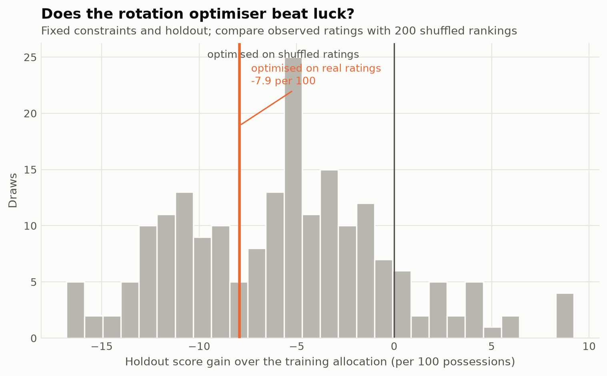
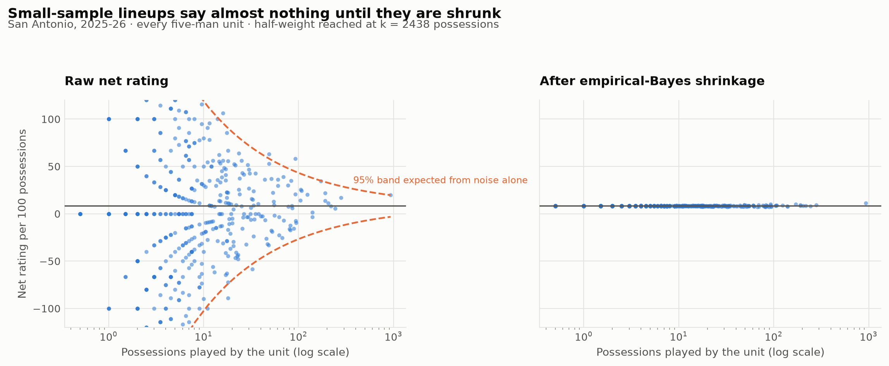
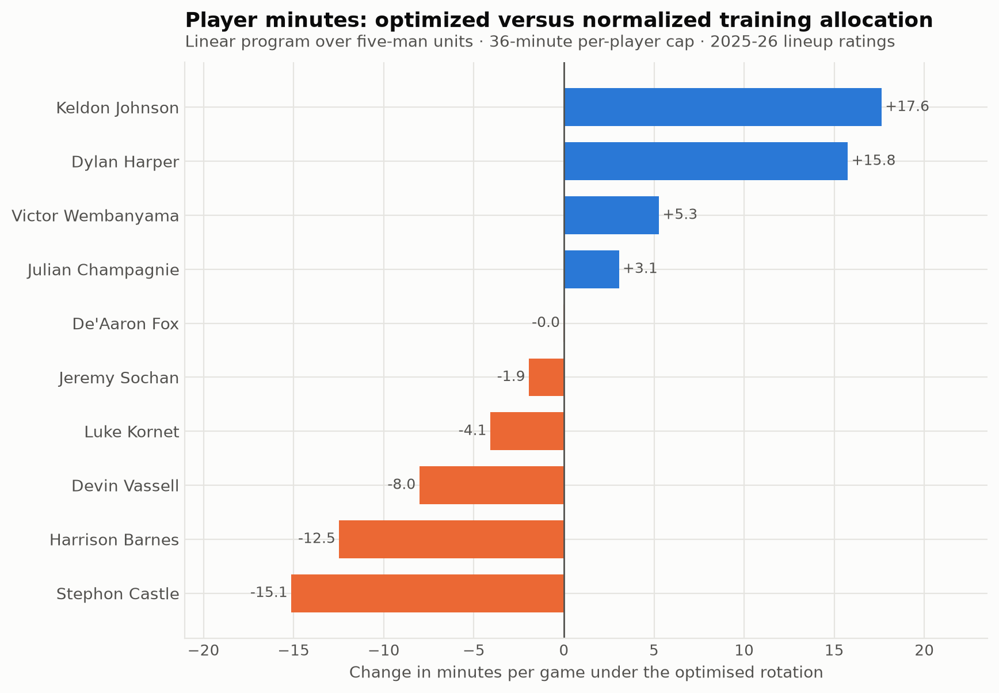

# A rotation optimizer can lose to the allocation it replaces

Joseph Smarrelli · September 2026

The constrained allocation performs **7.9 points per 100 worse** than the normalized training allocation when both are scored on later lineup outcomes. Its result sits at the **34.5th percentile** of 200 shuffled-rating runs. This exercise provides no evidence that the proposed allocation improves San Antonio’s rotation.

The later games provide a reason to reject this allocation and reconsider the information entering the optimizer.

## Establish the comparison before optimizing

The eligible regular-season sample splits chronologically into **44 training games and 30 later games**. Training data determine the player pool, the most-used unit and the lineup ratings. The later outcomes are used only to score the proposed allocation and its comparator.

The comparator preserves training minutes across the same candidate lineups, then rescales them to 48 minutes. It is not the actual later rotation. A lineup missing from the later sample receives the training prior; here, all optimized minutes have a later rating.

## Shrink the small samples

Raw lineup net ratings vary sharply when a unit has only a few possessions. The descriptive full-sample fit estimates a half-weight point of **2438 possessions**. At that exposure, the lineup’s own rate and the team prior receive equal weight. The optimizer uses a separate training-only fit.

The estimator uses a variance decomposition and explicit fallback values when estimated variance components are nonpositive. It is a modeling choice, not a guarantee that the fitted spread captures every kind of lineup uncertainty.

## Read the allocation as a constrained exercise

The linear program allocates 48 minutes, caps each player at 36 and each lineup at 12, and requires at least eight minutes for the training sample’s most-used five. The player-minute comparison uses the same normalized baseline as the evaluation.

Opponent assignments, fatigue, foul trouble and availability are absent. Later lineup outcomes are also selected by the circumstances in which those units actually played. Reweighting those outcomes is an observational score, not a causal estimate of what a different rotation would have achieved.

The repository also includes descriptive five-man and two-man tables. The two-man residual compares a duo with a simple additive on-court reference. It does not isolate chemistry or synergy from shared teammates and opponents.

## Data and reproduction

Source: [pinned public NBA archive](https://github.com/shufinskiy/nba_data/tree/e829d4678be1e075f99e5d41a1c5f97089be446b). The repository includes the analysis code, source checksums, results, a review notebook and validation records. See the shared methods for reconstruction rules and limitations.
