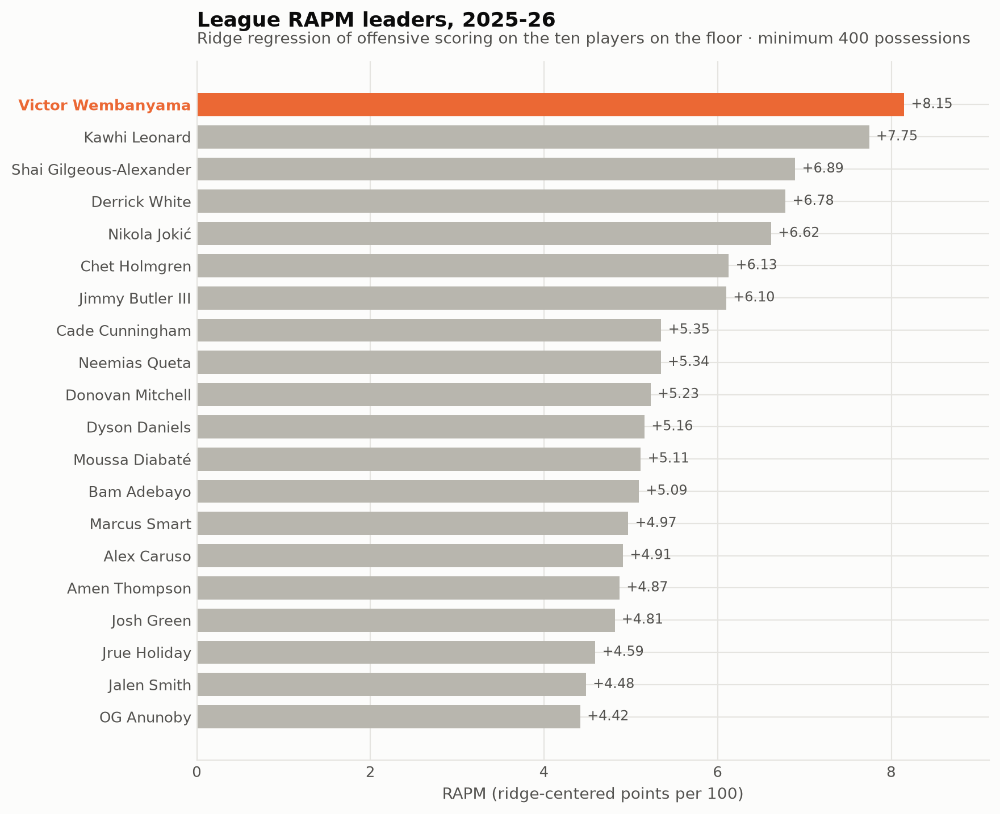
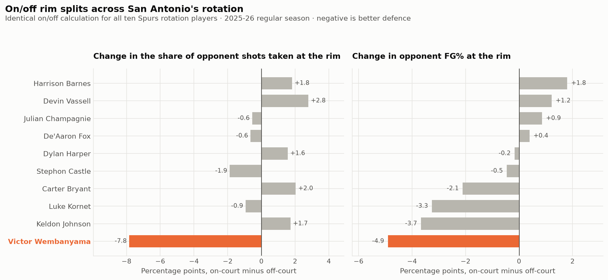
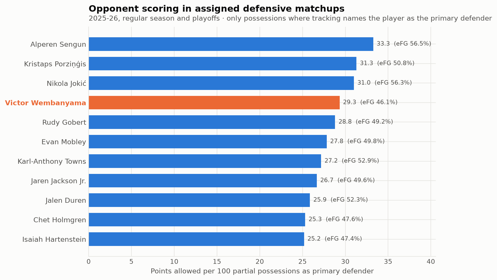

# Wembanyama: total impact and defensive indicators

Joseph Smarrelli · September 2026

Wembanyama ranks **1 of 463 qualified players** in this single-season ridge model, at **+8.15 total RAPM**. The separate on/off calculation finds a **-7.8-percentage-point** change in opponents’ share of attempts within six feet, and a **-4.9-point** change in conversion on those attempts.

Total RAPM combines offense and defense; it is not a defensive ranking. The rim and matchup summaries describe separate defensive indicators. They do not establish how many points are caused by Wembanyama alone.

## Adjusted plus-minus

The model fits team scoring rates to the listed offensive and defensive players, with stint exposure as a weight. All stints and both team perspectives from a game stay in the same validation fold. The selected ridge penalty is **2,000**, with a selection-fold weighted R² of **0.0062**.

That score is used to choose the penalty; it is not a second, untouched test of the selected model. The final coefficients are fitted to the eligible season. Positive defensive RAPM is obtained by reversing the sign of the defensive scoring coefficient. The baseline is ridge-centered, not replacement level.

## Opponent rim attempts

Shots join to lineups by game, event and player ID. This avoids assigning a shot to a substitution that happened at the same displayed clock. The on/off sample uses games whose lineups pass the shared eligibility screen.

Running the same split for teammates provides context. It does not turn those teammates into a matched control group. Shared minutes, different opponents, score states and rotation decisions remain mixed into the comparison. Neither the bars nor the point estimates should be treated as a causal ranking.

## Assigned matchups

The matchup extract places the scorer in the outer player record and the defender in the nested matchup record. Defensive summaries group by the nested defender ID. Wembanyama’s sample records **29.3 opponent player points per 100 partial matchup possessions** across the regular season and playoffs.

That denominator measures partial assigned matchups, not team possessions. A value around 29 is therefore not a team defensive rating. Help, switches, offensive-player selection and tracking coverage still affect it. The matchup record cannot remove team defense from an individual result.

## A useful next review

Start with sequences that disagree with the aggregate profile: rim attempts conceded with Wembanyama present, successful contests while he is absent, and scoring credited in assigned matchups. Check the help action and the possession before assigning individual credit. The three views can organize that review; none substitutes for it.

## Data and reproduction

Source: [pinned public NBA archive](https://github.com/shufinskiy/nba_data/tree/e829d4678be1e075f99e5d41a1c5f97089be446b). The repository includes the analysis code, source checksums, results, a review notebook and validation records. See the shared methods for reconstruction rules and limitations.
