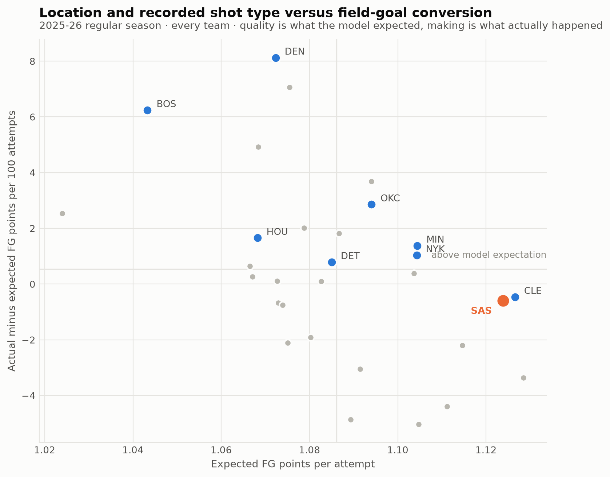
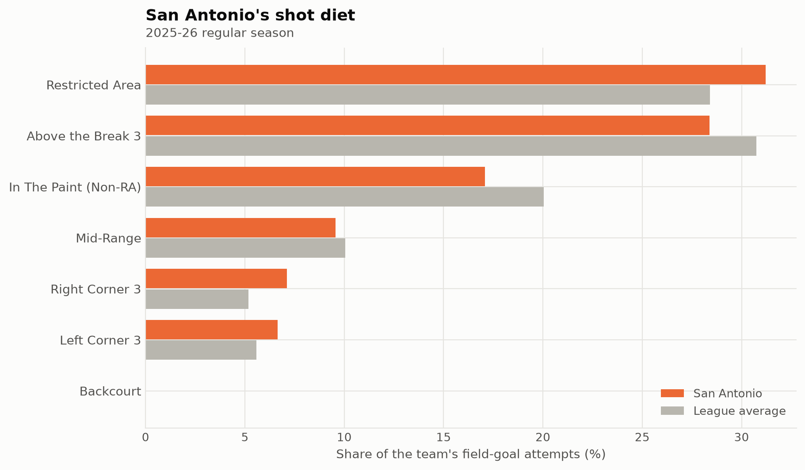

# Separating recorded shot context from conversion

Joseph Smarrelli · September 2026

San Antonio’s recorded attempts average **1.124 expected field-goal points** under this model. Actual conversion is **-0.60 points per 100 attempts** relative to that reference. This separates one description of the shot diet from the result, while leaving major parts of shot quality unobserved.

## Train on earlier seasons

A gradient-boosted classifier fits **1,251,267 regular-season attempts from 2019–20 through 2024–25**, then evaluates **219,160 attempts in 2025–26**. Inputs include coordinates, distance, recorded action type, zone, period and remaining period time.

The model’s held-out log loss is **0.6366**, compared with **0.6572** for zone make rates estimated on the training seasons. Both comparisons use outcomes that were unavailable when their predictions were constructed. Model Brier score is **0.2239** versus **0.2323**; AUC is **0.663** versus **0.637**.

## Interpret the residual narrowly

Expected points equal make probability times two or three. The residual is actual field-goal points minus that value. A positive residual means conversion exceeded the model’s reference, not that every extra point represents repeatable shooting skill.

Shooter ability is omitted, along with defender distance, passing sequence and openness. The remaining clock is the period clock, not the shot clock. Recorded action labels are retrospective scoring descriptions, so this is a contextual evaluation model rather than a live pre-release system. Long-distance attempts remain included.

## Connect the result to a review

The Spurs’ location distribution provides a starting point for examining how those attempts were created. A comparison should distinguish early open catches, pressured late-clock attempts and shots following offensive rebounds. Those situations can occupy the same broad zone but have very different difficulty.

The results do not prove that shot creation is stable while conversion will regress. Both the composition of attempts and the players taking them can change. Free throws and turnovers are also outside the shot feed, so this is not a complete offensive-efficiency model.

The delivered evaluation rows retain game and event IDs, outcomes and both probabilities. A reviewer can recalculate the published scores without trusting a screenshot or a rounded headline.

## Data and reproduction

Source: [pinned public NBA archive](https://github.com/shufinskiy/nba_data/tree/e829d4678be1e075f99e5d41a1c5f97089be446b). The repository includes the analysis code, source checksums, results, a review notebook and validation records. See the shared methods for reconstruction rules and limitations.
