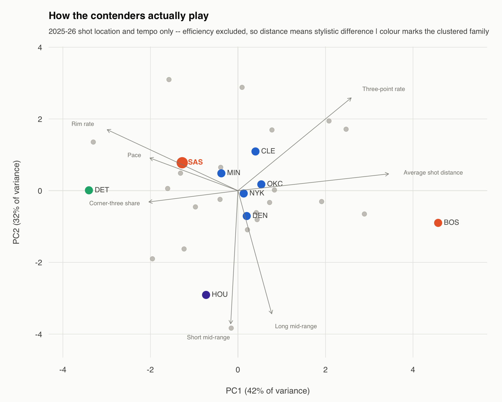
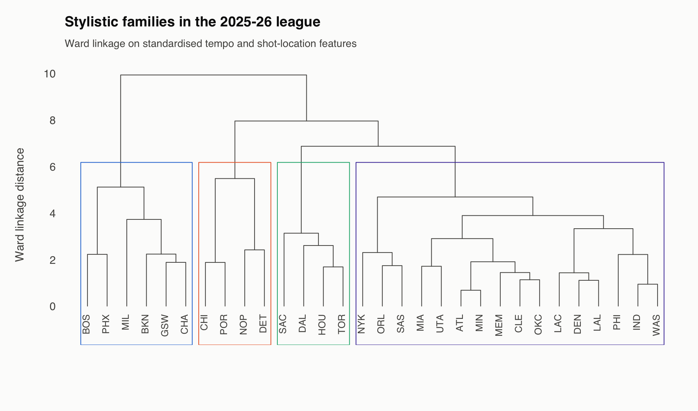
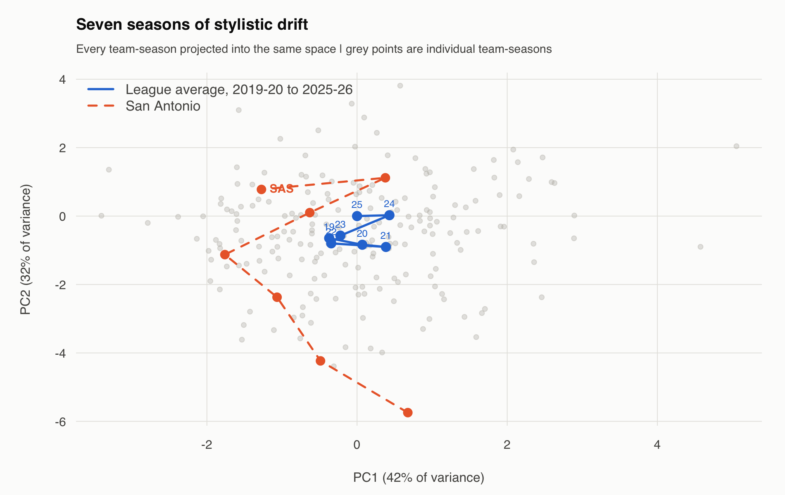

# Where the contenders sit in shot-location space

Joseph Smarrelli · September 2026

San Antonio and Oklahoma City occupy the same broad cluster in this seven-feature style description. Their group contains **16 teams**. That tells us the chosen features place them near a common part of the league; it does not show that their actions or defensive coverages are interchangeable.

## Describe style before labeling it

The inputs are pace, near-rim attempt share, short and long midrange shares, three-point rate, corner share among threes and average distance. Each feature is standardized before principal-components analysis. Efficiency does not enter the fit, so a nearby team is similar in this limited shot-location and tempo description, not necessarily equally strong.

PC1 is primarily associated with shot distance and three-point rate, while PC2 reflects the midrange shares. Both signs are arbitrary: reversing a component would preserve every distance and relationship. The complete loadings are supplied so the labels can be checked.

## Clusters are a summary choice

Ward clustering uses the standardized features and is displayed with four groups. The full tree matters because four is a chosen cut, not a statistically established number of basketball identities.

The large Spurs group includes ATL, CLE, DEN, LAC, LAL, MIA, MIN, NYK, ORL, IND, PHI, SAS, OKC, UTA, MEM, WAS. A single group containing more than half the league does not, by itself, demonstrate convergence over time. That would require a defined measure of dispersion and a separate longitudinal comparison.

## Read the historical path carefully

Historical team-seasons are projected into one fitted coordinate system. This makes a retrospective trajectory readable, but the map uses the current reference basis; it is not a backtest of forecasts made in earlier years. The Spurs’ path also need not match the league mean merely because a few plotted points are nearby.

For scouting, the map can help choose comparisons to examine on film. Transition attacks and post entries can produce similar rim shares. Their tactical responses may be very different. Turnovers, rebounding, off-ball movement and defender positioning are absent from this feature set, so the next step is to identify the actions behind the locations.

## Data and reproduction

Source: [pinned public NBA archive](https://github.com/shufinskiy/nba_data/tree/e829d4678be1e075f99e5d41a1c5f97089be446b). The repository includes the analysis code, source checksums, results, a review notebook and validation records. See the shared methods for reconstruction rules and limitations.
