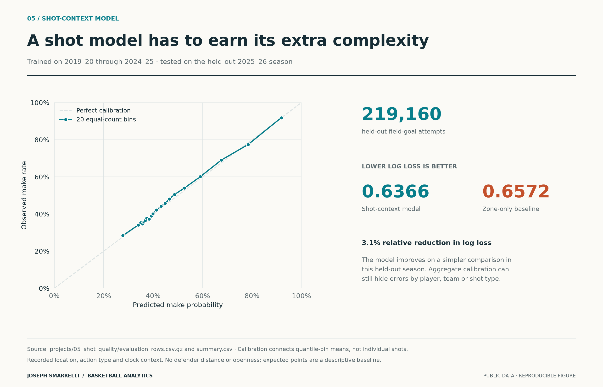

# Decision brief: use expected points as a reference, not a verdict

AI-assisted synthesis of Project 05, October 22, 2026. Recommendations below are proposed uses, not claims of deployment by a team.

**Decision:** use the recorded-context model to separate a description of the shot diet from conversion. Keep a zone-only baseline in every model review and avoid treating actual-minus-expected as isolated shooting skill.

**Evidence:** on 219,160 held-out 2025–26 attempts, log loss is 0.63661 versus 0.65723 for the zone baseline, a 3.1% relative reduction in this loss metric. Brier score is 0.22386 versus 0.23227. Training covers 1,251,267 earlier-season attempts. San Antonio's expected field-goal points per attempt are 1.124, while actual conversion is −0.60 points per 100 attempts relative to that reference. These are field-goal measures; they exclude turnover and free-throw value.

**Proposed next step:** review calibration and residuals separately by team, zone and recorded action type on a future locked holdout. Examine whether an apparent conversion deficit is concentrated in a recurring shot family. Validate source definitions before comparing seasons. If staffing a full possession-quality model, add the missing scoring and possession-ending channels rather than relabeling this field-goal model.

**What would change the recommendation:** a later-season reversal versus the simple baseline, subgroup miscalibration, source-definition drift or clear evidence that omitted openness/defender-distance information dominates the comparison. Better log loss does not by itself establish a useful basketball decision threshold.

**Interview defense:** the calibration curve groups shots by predicted probability. Its 20 quantile bins are not 20 independent tests, and a visually close aggregate line can conceal subgroup errors. The October visual rebuild recalculated log loss and Brier scores from saved evaluation rows and checked them against the published summary; it did not retrain the large source model.

Sources: [full study](05_shot_quality.md), [project source](../projects/05_shot_quality/analysis.py), [summary](../projects/05_shot_quality/summary.csv), and [execution limits](../VALIDATION_CURRENT.md).
