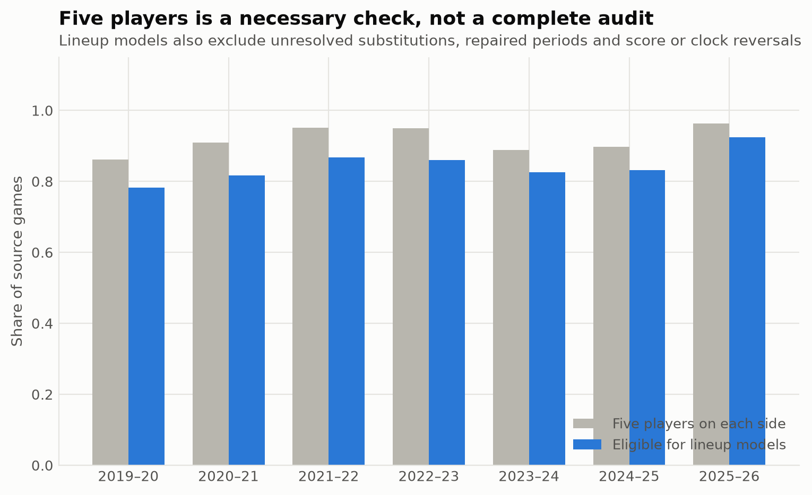

# When a lineup reconstruction is ready to use

Joseph Smarrelli · September 2026

A lineup file can contain five names on each side and still be wrong. A substitution may be unresolved, a period-opening unit may have been filled in from a roster, or a corrected score may have been assigned to the wrong stint. Those errors matter because every downstream rating inherits them.

This pipeline separates score accounting from lineup eligibility. It reconstructs **8,782 of 8,879 source games** across seven regular seasons and their playoffs. Stint points reconcile with the source final scores in every reconstructed game. Missing roster information still prevents reconstruction for some games.

## The stricter lineup sample

For 2025–26, **1,136 of 1,230 regular-season games** qualify for the lineup models. A game must retain five players per side, require no guessed period repair, have no unresolved substitution and avoid score decreases or reversed clocks. This is a stricter screen than checking lineup size alone.

The raw reconstruction remains available for score accounting. Analyses that require player identities use the eligible subset. Finals quarter totals can therefore use a game whose score accounting is sound even when its substitution record does not support a reliable player-level claim.

## Keep event order and game time separate

The parser follows `actionId` for chronological order. It retains `actionNumber` for linking to shot events, where the matching key has a different purpose. Substitution names are resolved within each game roster after normalizing accents and punctuation.

Stints split at lineup changes and period boundaries. Scoring uses event-to-event changes in the running score, including the first scoring event in a stint. Duration runs from an event to the next event; summing only the gap between the first and last event of each stint would lose time between adjacent stints.

## Count endings carefully

Made shots, ordinary final made free throws, defensive rebounds and turnovers generally end an offensive sequence. An and-one remains one sequence through the free throw or following rebound. Special free throws that retain possession do not become ordinary endings. A period buzzer is counted only when the parser sees a live sequence still in progress.

The resulting stint exposure divides combined team endings by two. It is an approximation for short stints, where one side may have more possessions than the other. It is useful for a consistent research denominator, but should not be presented as an official possession-level feed.

## What passing the audit establishes

The checks establish accounting consistency and flag several common reconstruction failures. They do not prove that every inferred opening lineup is correct. A coach-facing player analysis still needs targeted review around substitutions and disputed events. The per-game eligibility and reconciliation files make those checks possible without hiding the excluded records.

## Data and reproduction

Source: [pinned public NBA archive](https://github.com/shufinskiy/nba_data/tree/e829d4678be1e075f99e5d41a1c5f97089be446b). The repository includes the analysis code, source checksums, results, a review notebook and validation records. See the shared methods for reconstruction rules and limitations.
