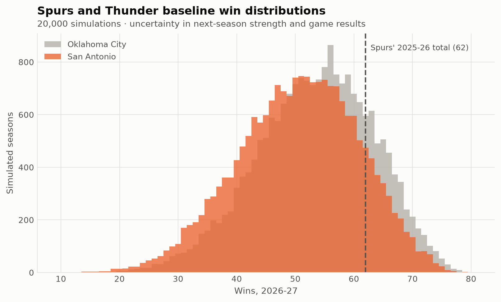
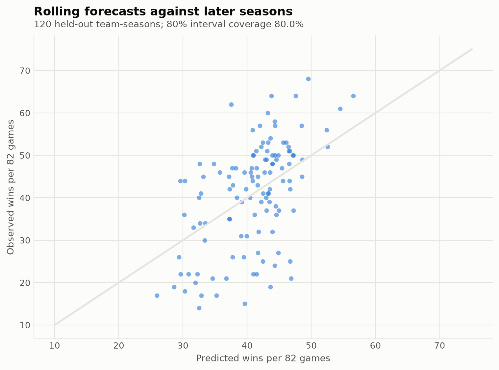
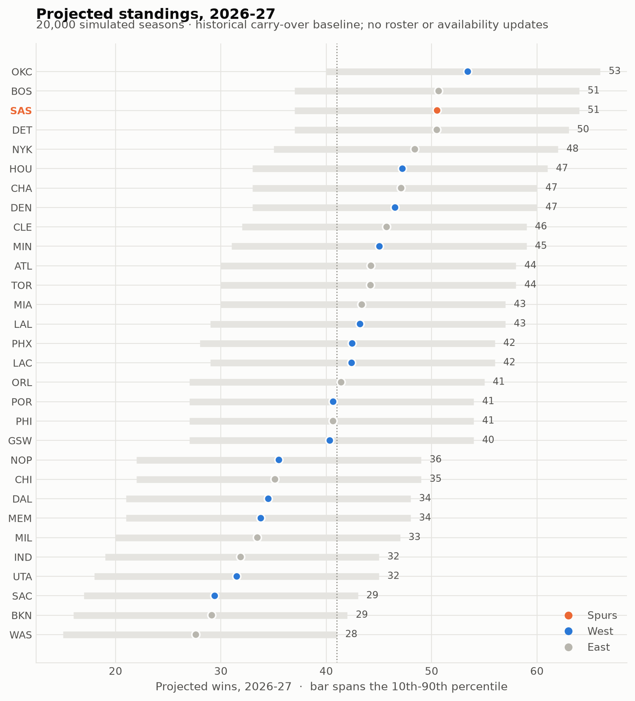

# A historical baseline for the next season

Joseph Smarrelli · September 2026

A strong season should improve the next forecast without being copied straight into it. This model uses historical team net-rating carry-over to produce a baseline distribution for 2026–27. San Antonio’s mean is **50.5 wins**, with a 10th–90th percentile range of **37–64**. Oklahoma City’s mean is **53.4**.

This is a completed-season baseline. It contains no offseason transaction adjustments, current injury information or sportsbook comparison. Those would require separate inputs and validation before the model could become a current roster forecast.

## Evaluate forward in time

For each evaluation year, the carry-over and wins conversion models fit only seasons already available. The test contains **120 later team-seasons**. Historical win totals are scaled to 82 games so shortened seasons do not create an artificial forecasting error.

The rolling mean absolute error is **8.56 wins**, mean error **+0.09**, and coverage of the nominal 80% interval **80.0%**. The interval combines estimated strength variation with a fixed within-season wins allowance. Coverage checks that approximation over this sample; it does not validate every component of the playoff simulation.

## Carry uncertainty through the schedule

The final carry-over slope is **0.536**, with residual standard deviation **4.48 net-rating points**. Each of 20,000 simulations draws team strengths around that baseline, then adds game-level noise and estimated home advantage.

The schedule is a synthetic 82-game slate, not the published NBA schedule. It preserves conference opponent-frequency totals but does not model travel, rest, back-to-backs or the league’s actual division schedule. Ties in the standings use a random tie break rather than simulated “true strength,” which would give the model information unavailable to the standings rules.

## Keep the playoff path fixed

The play-in supplies seeds seven and eight. The first-round 1/8 winner meets the 4/5 winner, while 2/7 meets 3/6. Surviving teams follow those fixed paths; a lower seed does not trigger reseeding. Within-conference home advantage follows seed position. Best-of-seven probabilities use the 2–2–1–1–1 home pattern.

The output includes title probabilities, but their assumptions are broader than the rolling win-total evaluation. They should be read as scenario outputs. They do not establish that a market price is wrong or that an unmodeled roster change has no value.

The most useful extension is to add verified current inputs one at a time and compare their forecasts with this baseline. That preserves a clear answer to whether the added complexity actually helps.

## Data and reproduction

Source: [pinned public NBA archive](https://github.com/shufinskiy/nba_data/tree/e829d4678be1e075f99e5d41a1c5f97089be446b). The repository includes the analysis code, source checksums, results, a review notebook and validation records. See the shared methods for reconstruction rules and limitations.
