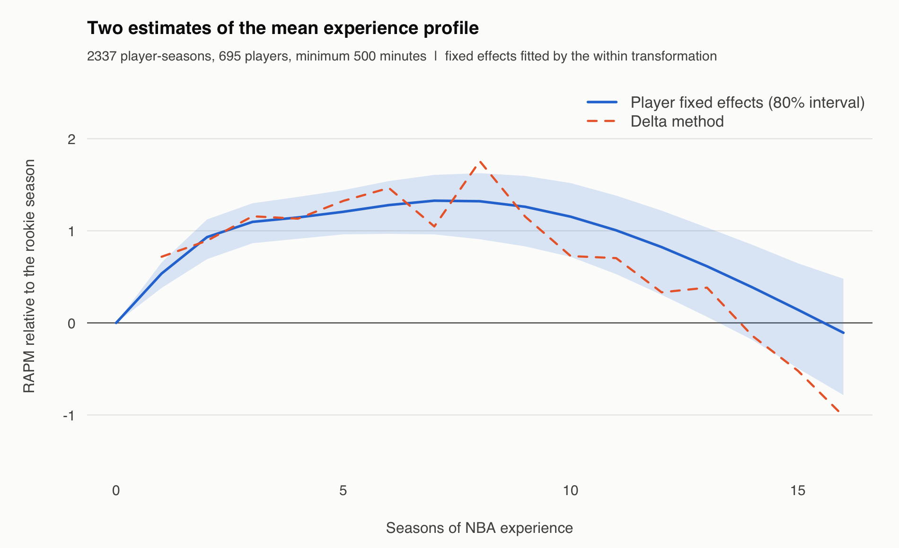
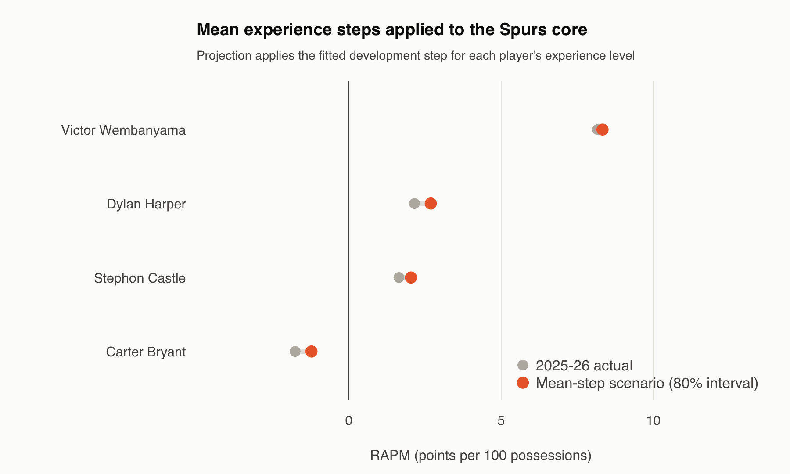

# What an experience curve can tell the Spurs

Joseph Smarrelli · September 2026

The estimated mean step is larger for the least experienced members of San Antonio’s core. That provides a useful baseline for development planning. It does not identify any player’s ceiling.

| Player | Experience in 2025–26* | Mean next-season step | 80% interval for mean step |
| --- | ---: | ---: | ---: |
| Carter Bryant | 0 | +0.54 | +0.38 to +0.66 |
| Stephon Castle | 1 | +0.40 | +0.31 to +0.47 |
| Dylan Harper | 0 | +0.54 | +0.38 to +0.66 |
| Victor Wembanyama | 2 | +0.17 | +0.10 to +0.24 |

*Experience is elapsed seasons since the first recorded shot-log season: a rookie season is zero. The next-season step moves from that level to the next one. It is a proxy for experience, not a player’s age.*

## Compare two estimators

The delta estimator takes changes between consecutive player-seasons, weights them by the smaller minutes total and cumulates the mean changes. The fixed-effects estimator fits a natural spline after demeaning the rating and spline columns within each player. Both use repeated observations; neither observes the counterfactual rating of a player who leaves the league.

The fixed-effects curve is smoother. The delta curve contains larger swings in later experience groups. Similar early slopes support an average early-career pattern, but divergence farther along the curve should remain visible rather than being edited into a single precise peak year.

## Keep the uncertainty attached to the right quantity

The spline intervals come from 400 bootstrap samples of players, preserving a player’s seasons together. The displayed 80% interval describes uncertainty in the mean experience step. It excludes the much larger variability in an individual player’s next season and does not include uncertainty from refitting every upstream RAPM model.

The point labeled as a scenario adds that mean step to the player’s current fitted rating. It is not a calibrated individual forecast. Different entry ages, injuries, role changes, team context and selection into playing time can all overwhelm the average step.

## Use the curve as a baseline, then examine the player

A staff could compare a proposed development expectation with the league’s experience pattern, then explain the player-specific reasons for a difference. For Castle or Harper that might mean a concrete change in role or skill evidence; for Wembanyama it could involve responsibilities not captured by average experience.

The ratings are estimated from eligible reconstructed games and use a different qualification threshold from the individual impact study. That specification explains the small differences between the two rating tables. The R analysis runs with base R and its standard `splines` library.

## Data and reproduction

Source: [pinned public NBA archive](https://github.com/shufinskiy/nba_data/tree/e829d4678be1e075f99e5d41a1c5f97089be446b). The repository includes the analysis code, source checksums, results, a review notebook and validation records. See the shared methods for reconstruction rules and limitations.
