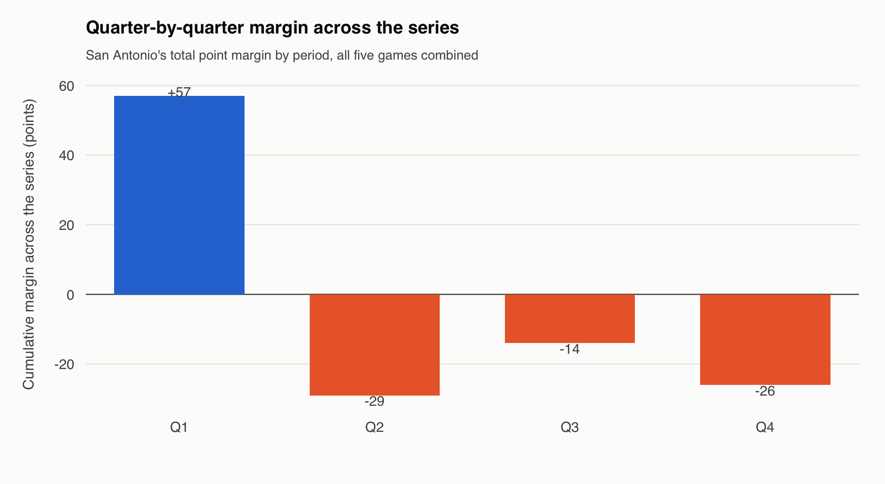
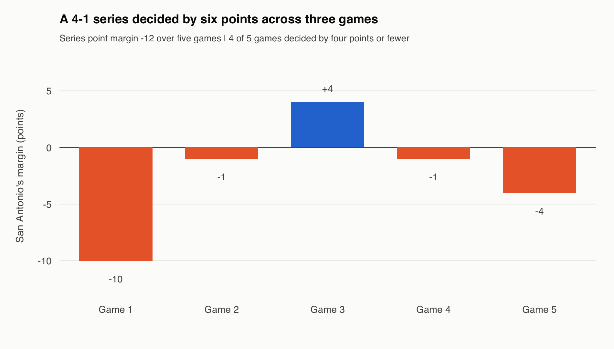
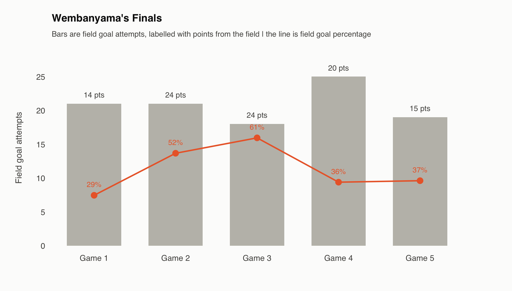

# The first-quarter lead and the rest of the Finals

Joseph Smarrelli · September 2026

San Antonio finished the five-game series **−12 in total points** despite a **+57 first-quarter margin**. The other quarters combine to −69. Those are distinct descriptions of the same series, and the quarter split is a useful starting point for review.

| Quarter | Spurs points | Knicks points | Margin |
| --- | ---: | ---: | ---: |
| 1 | 158 | 101 | +57 |
| 2 | 124 | 153 | -29 |
| 3 | 123 | 137 | -14 |
| 4 | 105 | 131 | -26 |

## Separate timing from the reason

The split does not identify starters as superior or the bench as responsible. Starting lineups can remain on court after the first quarter; reserves can appear within it. Lineup quality, matchups, score effects and tactical changes need their own evidence. A quarter label does not isolate any of them.

Stint points preserve period boundaries and sum to the source game scores. The scoring summary uses all reconstructed Finals games, including two whose substitution records fail the stricter player-lineup screen. Those games support score accounting, but not an unqualified inference about the players responsible.

## Shooting is only part of the account

The shooting tables cover field goals. Effective field-goal percentage adjusts for the extra value of threes, but it does not measure shot quality. Winning that percentage comparison in a loss cannot establish that shooting played no role, nor explain the free-throw, turnover and rebound differences.

Wembanyama’s locations and conversion changed across the five games. The records show those changes; they do not prove that New York forced a particular location or that a different location would have changed the series. Film and possession context are needed to connect the result to a defensive action.

## What the resampling exercise measures

Sampling stints with replacement within each of the observed games produces three or more Spurs game wins in **39.9% of 20,000 resamples**. Tied resampled margins receive a random winner.

This is a sensitivity exercise, not a chance that San Antonio “deserved” to win the Finals. Sampling changes how often particular stints appear, their aggregate playing time and their scoring mix. It does not merely reorder a fixed collection of possessions. It also does not simulate games six and seven or the response of either team to a different series state.

The defensible use is to show how sensitive a five-game summary is to its observed segments. The coaching use is to identify the quarters and sequences worth examining next, while keeping the explanation separate from the accounting.

## Data and reproduction

Source: [pinned public NBA archive](https://github.com/shufinskiy/nba_data/tree/e829d4678be1e075f99e5d41a1c5f97089be446b). The repository includes the analysis code, source checksums, results, a review notebook and validation records. See the shared methods for reconstruction rules and limitations.
